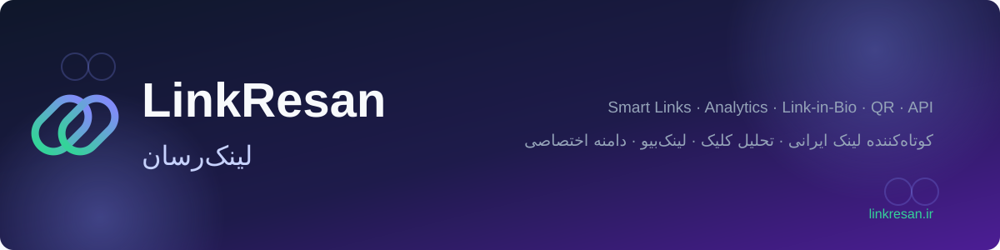

# LinkResan · لینک‌رسان

**پلتفرم ایرانی مدیریت لینک: کوتاه‌کننده لینک، تحلیل کلیک، دامنه اختصاصی، لینک‌بیو، QR و API**
**The Persian-first smart link platform: short links, click analytics, custom domains, link-in-bio, QR & API**

[🌐 وب‌سایت / Website](https://linkresan.ir) · [💳 قیمت‌گذاری / Pricing](https://linkresan.ir/pricing) · [📚 دانش‌نامه / Knowledge](https://linkresan.ir/knowledge) · [❓ سوالات متداول / FAQ](https://linkresan.ir/faq) · [🚀 آخرین تغییرات / Releases](https://linkresan.ir/releases)

---

## 📥 دانلود اپ موبایل · Mobile App Downloads

از نسخه **v7.16.0** اپ لینک‌رسان **کاملاً Native** است — اندروید با Kotlin + Jetpack Compose و iOS با SwiftUI. حجم APK فقط **۲.۸ مگابایت** (۹۷٪ کمتر از نسخه React Native قبلی). نسخه فعلی: **v7.19.0** — فارسی پیش‌فرض در اولین اجرا، تعویض زبان در صفحه ورود و اصلاح خطای ورود.

| پلتفرم | فایل | لینک مستقیم |
|---|---|---|
| 🤖 Android (APK) | `LinkResan-Android-v7.19.0.apk` — **فقط ۲.۸MB** | [⬇️ دانلود مستقیم APK v7.19.0](https://github.com/LinkResan/LinkResan/releases/download/v7.19.0/LinkResan-Android-v7.19.0.apk) |
| 🤖 Android (AAB — برای Google Play) | `LinkResan-Android-v7.19.0.aab` | [⬇️ صفحه Release و همه فایل‌ها](https://github.com/LinkResan/LinkResan/releases/tag/v7.19.0) |
| 🍎 iOS (Simulator) | `LinkResan-iOS-Simulator-v7.19.0.zip` | [⬇️ صفحه Release و همه فایل‌ها](https://github.com/LinkResan/LinkResan/releases/tag/v7.19.0) |

> ⚠️ برای نصب مستقیم، ابتدا نسخه قبلی (React Native) را حذف کنید — امضای اپ عوض شده.
> 🍎 نسخه iOS فعلی بیلد **شبیه‌ساز** است (برای اجرا روی Mac). نصب روی آیفون واقعی پس از فعال‌سازی حساب Apple Developer و TestFlight فعال می‌شود.
> The current iOS artifact is a **Simulator build** (runs on macOS). Real-device installation via TestFlight activates after Apple Developer enrollment.

- 📖 راهنمای نصب فارسی: [`mobile/README.md`](https://github.com/AmirMotefaker/LinkResan-Production/blob/main/mobile/README.md)
- 🛠️ هویت اپ: `ir.linkresan.mobile` — بیلد خودکار با هر تغییر روی `mobile/**`

---

## درباره لینک‌رسان

**لینک‌رسان (LinkResan)** یک پلتفرم ایرانی مدیریت هوشمند لینک است که در [linkresan.ir](https://linkresan.ir) ارائه می‌شود. لینک‌رسان به کاربران، تولیدکنندگان محتوا، تیم‌های رشد و توسعه‌دهندگان کمک می‌کند لینک‌های خود را **بسازند، کوتاه کنند، مدیریت کنند، تحلیل کنند و رشد دهند** — همه در یک تجربه کاملاً فارسی و راست‌به‌چپ.

### قابلیت‌های اصلی

| حوزه | قابلیت‌ها |
|---|---|
| 🔗 مدیریت لینک | کوتاه‌کننده لینک، اسلاگ دلخواه، تاریخ انقضا، محدودیت کلیک، لینک رمزدار، ساخت انبوه CSV |
| 📊 تحلیل | آمار کلیک زنده، تحلیل دستگاه و مرورگر، گزارش‌های Excel جدول‌بندی‌شده، نمای ۳۶۰ درجه کاربر |
| 🌐 برندینگ | دامنه اختصاصی، QR Code، لینک‌بیو (bio page)، Smart Links با مسیریابی کشوری و دستگاهی |
| 🧩 پلتفرم | API Keys، Webhooks، مدیریت تیم، پرداخت ریالی با اعمال سهمیه سمت سرور |
| 📱 موبایل | اپ اندروید (APK) و iOS با هویت رسمی `ir.linkresan.mobile` |
| 🧠 دانش | دانش‌نامه فارسی خودکار، صفحه سوالات متداول، مرکز تغییرات |

### اعداد امروز (زنده در سایت)

**۱۱۹+ کاربر ثبت‌نام‌شده · ۱۴۰+ لینک ساخته‌شده · ۴٬۵۰۰+ کلیک ثبت‌شده** — این آمار با به‌روزرسانی هر ۲۰ ثانیه در [صفحه اصلی](https://linkresan.ir) به‌صورت زنده نمایش داده می‌شود.

### چرا لینک‌رسان؟

- ✅ **فارسی‌محور واقعی:** رابط کاربری کامل RTL، پشتیبانی از اعداد فارسی و تجربه بومی
- ✅ **شفافیت کامل:** تاریخچه تغییرات تأییدشده در [صفحه آخرین تغییرات](https://linkresan.ir/releases) و [Release Ledger](https://github.com/LinkResan/LinkResan/blob/main/docs/RELEASE_LEDGER.md)
- ✅ **اعتماد مهندسی:** هدرهای امنیتی HSTS/CSP، احراز هویت سمت سرور، سیاست public-safe در انتشار
- ✅ **سئو و GEO آماده:** محتوای ساختاریافته برای موتورهای جست‌وجو و دسترسی باز خزنده‌های هوش مصنوعی (GPTBot، ClaudeBot، Gemini و…)

---

## About LinkResan

**LinkResan** is a Persian-first smart link management platform available at [linkresan.ir](https://linkresan.ir). It combines a **URL shortener**, **click analytics**, **custom domains**, **QR codes**, **link-in-bio pages** and a developer **API** in one product built natively for Persian (Farsi) users and RTL interfaces.

### Feature highlights

| Area | Capabilities |
|---|---|
| 🔗 Link Management | URL shortener, custom slugs, expiry, click limits, password-protected links, bulk CSV creation |
| 📊 Analytics | Live click stats, device & browser breakdown, tabulated Excel exports, 360° user view |
| 🌐 Branding | Custom domains, QR codes, link-in-bio, Smart Links with country/device routing |
| 🧩 Platform | API keys, webhooks, team management, Rial billing with server-authoritative entitlements |
| 📱 Mobile | Android (APK) and iOS apps with the official identity `ir.linkresan.mobile` |
| 🧠 Knowledge | Autonomous Persian knowledge engine, FAQ hub, verified release center |

### Engineering snapshot

| Layer | Technology |
|---|---|
| Web | Next.js 16 · React 19 · TypeScript |
| Backend | Go (Fiber) · PostgreSQL · Redis |
| Mobile | کاملاً Native — Kotlin + Jetpack Compose (اندروید) و SwiftUI (iOS) |
| Delivery | Cloudflare edge · Render backend · GitHub Actions CI with health gates |

### Trust & transparency

- `Shipped` / `Partial` / `Preview` states are reported honestly — nothing in preview is advertised as shipped.
- Security headers (HSTS, CSP), server-side authentication and server-authoritative plan enforcement.
- Public content follows a strict **public-safe boundary**: no credentials, customer data or private topology is ever published.

---

## 🗺️ Explore · کاوش

| | |
|---|---|
| 🌐 Product / محصول | [linkresan.ir](https://linkresan.ir) |
| 💳 Pricing / قیمت‌گذاری | [linkresan.ir/pricing](https://linkresan.ir/pricing) |
| 📚 Knowledge base / دانش‌نامه | [linkresan.ir/knowledge](https://linkresan.ir/knowledge) |
| ❓ FAQ / سوالات متداول | [linkresan.ir/faq](https://linkresan.ir/faq) |
| 🚀 Release center / مرکز تغییرات | [linkresan.ir/releases](https://linkresan.ir/releases) |
| 📦 Public repository / مخزن عمومی | [LinkResan/LinkResan](https://github.com/LinkResan/LinkResan) |
| 🧭 Roadmap | [docs/ROADMAP.md](https://github.com/LinkResan/LinkResan/blob/main/docs/ROADMAP.md) |
| 🛡️ Security / امنیت | [docs/SECURITY.md](https://github.com/LinkResan/LinkResan/blob/main/docs/SECURITY.md) |

## Governance · فرایند مهندسی

`Issue → Branch → Commits → Pull Request → Review → Merge → Release record`

`LinkResan/LinkResan` is the canonical **public product & development record**; the commercial production implementation stays private. The organization never publishes proprietary source, secrets, customer data or deployment topology.

مخزن عمومی، سابقه قابل‌حسابرسی توسعه لینک‌رسان را نگه می‌دارد؛ پیاده‌سازی تجاری Production به‌صورت خصوصی نگهداری می‌شود و هرگز سورس اختصاصی، اطلاعات مشتریان یا توپولوژی استقرار منتشر نمی‌شود.

---

**لینک فقط کوتاه نمی‌شود؛ هوشمند، قابل‌اندازه‌گیری و قابل‌مدیریت می‌شود.**
**A link should not just be shorter — it should be smart, measurable and manageable.**

[🌐 linkresan.ir](https://linkresan.ir) · [⬇️ دانلود اپ / Get the app](https://github.com/LinkResan/LinkResan/releases/tag/v7.15.0)

